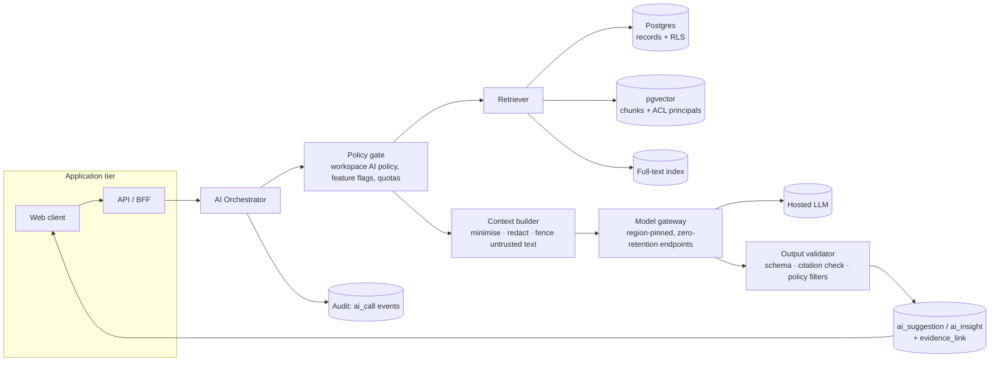

# AI Intelligence Layer

Status: Foundation draft · 2026-10-22

## 1. Stance

AI in Meridian is **infrastructure for trustworthy context**, not a chatbot. It has three jobs:
1. **Reduce capture effort**: turn unstructured notes into proposed structured records.
2. **Compress context**: brief a person on a stakeholder or initiative in seconds.
3. **Surface attention**: flag what has changed or slipped, using deterministic signals first and AI only to explain them.

Every capability is useful with AI turned off: manual creation, deterministic signals, and reports without narrative still work.

## 2. Capabilities

| Capability | Trigger | Input (minimised) | Output | Human gate |
|---|---|---|---|---|
| **Stakeholder briefing** | Open profile / before a meeting (calendar, v1.1) | Profile fields, classifications history, last N engagements (summaries), open decisions/commitments, relationships | 5–8 bullet briefing + "open items" list, each bullet cited | Read-only; cached until underlying records change |
| **Meeting intelligence** | "Extract" on an engagement | Engagement notes/transcript, participant list (names + ids), initiative name | Summary draft; proposed decisions, commitments, actions, stance changes, new participants, each with **source span** | Every item accepted/edited/rejected individually |
| **Relationship intelligence** | Map side panel, path finder | Scoped subgraph + evidence | Explanation of a path or cluster in plain language, citing relationship evidence | Read-only; suggested relationships require acceptance |
| **Engagement signals** | Nightly + on write | Deterministic metrics (see §4) | Signal records; AI only writes the one-line explanation | Users dismiss/snooze; signals never alter records |
| **Executive intelligence** | Report generation | Aggregates + selected records for the period | Summary narrative, every sentence cited | User edits before export |
| **Natural-language search (Ask)** | ⌘K `?` | Question + retrieved, permission-filtered chunks | Answer with citations; "I couldn't find evidence for that" when unsupported | Read-only; saving to report is explicit |

Out of scope by policy: predicting individual behaviour or intentions; personality, emotion or "sentiment score" profiling of named people; inferring protected characteristics; drafting and *sending* communications autonomously.

## 3. Architecture

**Key design decisions**
- **Retrieval is permission-aware at the query, not the result.** The retriever runs as the requesting user. Postgres RLS plus ACL principals stored on each vector/FTS chunk ensure unauthorised content never enters the prompt. Post-filtering would be insufficient, because content leaks through summaries.
- **Hybrid retrieval:** structured SQL for facts (open commitments, dates, classifications) + BM25 + vector similarity for unstructured notes; results merged with reciprocal-rank fusion and capped by token budget.
- **Structured outputs everywhere.** Extraction, briefings and summaries return JSON matching a schema, where every claim carries `citations: [{source_type, source_id, span?}]` and `kind: "fact" | "inference"`.
- **Citation verification.** The validator checks that each cited `source_id` was in the supplied context and that quoted spans exist verbatim in the source text. Claims failing verification are dropped and logged, not shown.
- **Model gateway** abstracts providers. Default: Anthropic Claude via region-pinned cloud endpoints (AWS Bedrock / Google Vertex in the workspace's region) with zero-data-retention terms. Tiering: a fast model (Claude Haiku 5.5 class) for classification and span-matching; a strong model (Claude Sonnet 5.5 class) for extraction, briefings and summaries; the most capable model (Opus class) reserved for offline evaluation grading. Model and prompt versions are recorded on every output.
- **Embeddings** generated in-region; stored with `workspace_id`, record ids and ACL principals; re-embedded on edit; deleted on record purge.

## 4. Engagement signals (deterministic first)

| Signal | Rule (configurable per template) | AI role |
|---|---|---|
| Overdue commitment | `due_on < today` and status open | None |
| Due soon | Due within 7 days, no recent activity | None |
| Approval stalled | Approval pending > N days past request | None |
| Cooling relationship | High-influence stakeholder; engagements in last 60 d < 50% of prior 60 d, or none in 90 d | One-line explanation with counts |
| Unowned key stakeholder | Influence ≥ High and no relationship owner | None |
| Stance shift | Classification changed toward Concerned/Opposed | Summarise rationale + evidence |
| Unresolved issue | Concern raised in ≥ 2 engagements without linked commitment/decision | Detected by extraction, **proposed** as a signal for review |
| Commitment without due date | Open commitment, no date | None |

Signals are explainable by construction: each stores its rule, inputs and evidence ids.

## 5. Mandatory safeguards

| Safeguard | Implementation |
|---|---|
| **Evidence for every material insight** | Schema-required citations; validator drops uncited claims; UI renders citation chips that open the source at the span. |
| **Facts vs inferences** | `kind` field per claim. Facts render in normal text; inferences render with an "Inferred" label and hedged phrasing enforced by prompt and post-check. |
| **No sensitive trait inference** | System prompt prohibition + output classifier screening for health, religion, ethnicity, sexuality, politics, union membership, family status. Matching claims are blocked and logged. Sensitive custom fields and sensitive relationship types are excluded from context. |
| **No claims about private intentions** | Prompts forbid speculating on motives; we report what was *said or recorded* ("stated concern about noise"), never "is planning to block". Eval set includes adversarial cases. |
| **Human confirmation** | AI writes only to `ai_suggestion`. Records are created only on explicit accept by a user with permission to create that record. No outbound communications are sent by AI. |
| **Tenant & record-level boundaries** | Retrieval as user with RLS + chunk ACLs; one workspace per request context; cross-tenant contamination tests in CI. Caches keyed by (workspace, user permission hash, record versions). |
| **Prompt-injection defence** | Imported documents, notes and emails are **untrusted data**: wrapped in delimited, labelled blocks; system prompt instructs that content inside cannot change instructions; the model has **no tools with side effects** during extraction/briefing; outputs are schema-validated; injection heuristics flag suspicious content ("ignore previous", hidden text, zero-width characters, HTML comments) and show a warning badge on the source; red-team suite in evals. |
| **Data minimisation** | Context builder sends only fields needed per capability (allow-list per feature); emails/phones redacted unless needed; summaries preferred over raw text for older engagements; token budget caps. |
| **Usage controls** | Workspace AI policy: on/off globally and per capability; per-initiative opt-out; exclude restricted records (default on); choose region/provider (Enterprise); monthly quota and per-user rate limits. |
| **Retention** | Provider zero-retention; prompts/outputs stored in our DB only as suggestions/insights (retained with the record); raw prompt logs retained 30 days for debugging (configurable 0–90, Enterprise), encrypted, admin-access audited. No customer data used for model training. |
| **Auditability** | `ai_call` audit event: user, capability, model, prompt version, record ids in context (not content), token counts, latency, outcome; acceptance/rejection recorded on the suggestion. Exportable. |
| **Confidence & uncertainty** | Three bands (High/Medium/Low) from a calibrated combination of model-reported certainty, explicitness of the source (stated vs implied), and citation verification. Low-confidence items are collapsed by default; "not enough evidence" is a first-class answer. No percentages are shown to users (false precision). |

## 6. Evaluation

AI quality is a release gate, not a dashboard.

| Eval suite | Dataset | Metrics | Gate |
|---|---|---|---|
| **Extraction** | 300+ synthetic and consented real meeting notes across templates, gold-labelled decisions/commitments/actions with owners and dates | Precision, recall, owner/date accuracy, span accuracy | Precision ≥ 0.85, recall ≥ 0.75 for commitments |
| **Citation faithfulness** | Briefings and summaries over fixture workspaces | % claims fully supported (LLM-judge + human audit sample), unsupported-claim rate | Unsupported ≤ 2%; 0 fabricated citations (validator-enforced) |
| **Fact/inference labelling** | Annotated claim sets | Mislabel rate | ≤ 5% |
| **Safety: sensitive traits & intentions** | Adversarial notes containing tempting cues | Violation rate | 0 in suite |
| **Prompt injection** | Documents with embedded instructions, hidden text, exfiltration attempts | Instruction-following rate, data-leak rate | 0 leaks; 0 side effects |
| **Tenant isolation** | Multi-tenant fixtures with canary strings | Canary appearance across boundary | 0 (hard fail) |
| **Permission-aware retrieval** | Users with varied access on shared fixtures | Restricted-content appearance | 0 (hard fail) |
| **Ask (Q&A)** | 200 questions with gold answers + "unanswerable" set | Answer correctness, correct abstention rate | Abstention ≥ 90% on unanswerable |
| **Latency & cost** | Production-like load | p50/p95 latency, $/active seat | Briefing p95 < 4 s first token < 800 ms; cost ≤ 12% of seat revenue |

- Run on every prompt/model change (CI) and nightly on production-sampled, consented, de-identified data.
- Online metrics: acceptance rate, edit distance on accepted items, rejection reasons, "this is wrong" reports per 1k insights.
- Prompt and model versions are pinned; changes ship behind flags with A/B comparison on the eval suite.

## 7. Failure & degradation

| Condition | Behaviour |
|---|---|
| Provider outage / timeout | Feature shows "AI unavailable, try again" inline; manual paths unaffected; retries with backoff; no silent fallback to a non-compliant region |
| Validator rejects all claims | "Couldn't produce a supported summary" with an option to view the underlying records |
| Context exceeds budget | Summarise oldest material first (hierarchical); disclose "Based on the most recent 40 of 112 engagements" |
| Quota exhausted | Admin notified; user sees remaining manual paths |

## 8. Phasing

| Phase | Capabilities |
|---|---|
| MVP | Meeting extraction + review, stakeholder briefing, initiative summary with citations, deterministic signals with explanations, AI policy controls, eval harness |
| v1.1 | Ask (NL search), calendar-triggered pre-meeting briefings, email ingestion extraction, natural-language filters |
| v1.5 | Relationship suggestions from co-attendance, stance-shift explanations, report scheduling |
| v2 | Bring-your-own-model (Enterprise), customer-visible eval reports, per-template fine-tuned extraction prompts |
