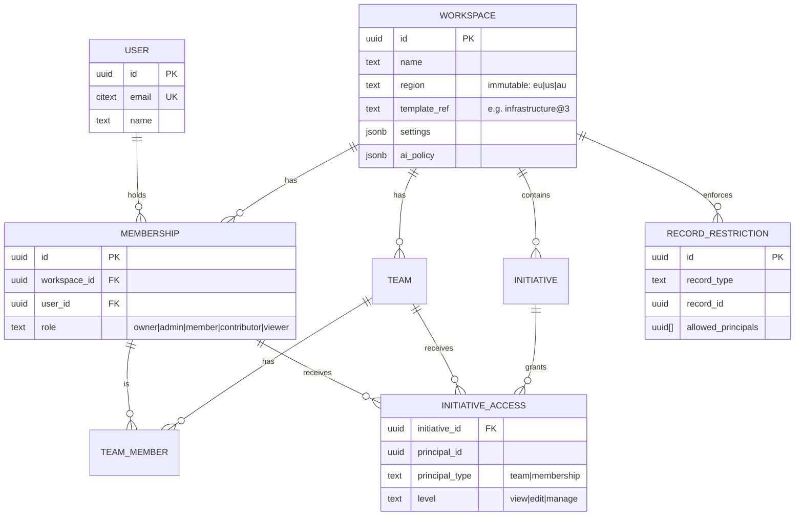
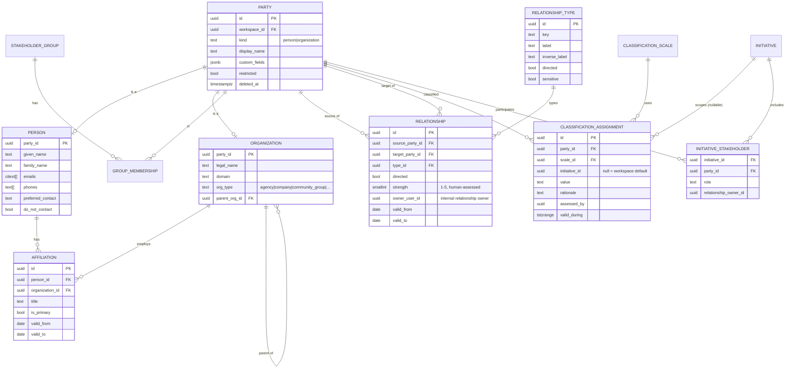
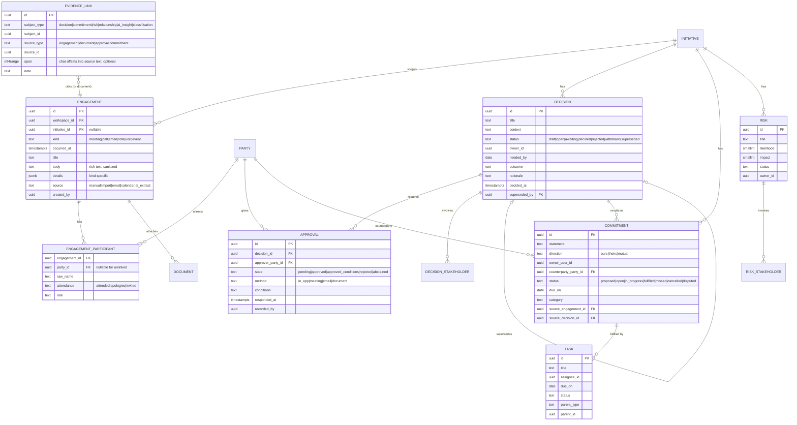
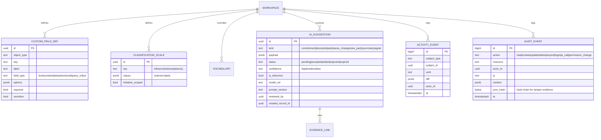

# Domain Model

Status: Foundation draft · 2026-10-22

## 1. Modelling principles

1. **First-class where behaviour differs.** An entity gets its own table when it has its own lifecycle, permissions, or queries. Everything else is configuration: classifications, custom fields, vocabularies.
2. **Time is a dimension, not an overwrite.** Affiliations, relationships, classifications and group memberships carry `valid_from`/`valid_to`. Edits that change meaning create new versions.
3. **Every row belongs to exactly one tenant.** `workspace_id` is on every tenant-scoped table and is enforced by Postgres Row-Level Security (RLS), not just application code.
4. **Evidence is a link, not a copy.** Decisions, commitments, risks and AI insights point to the engagements and documents that justify them through a polymorphic `evidence_link`.
5. **Soft delete + audit.** No hard deletes of business records in normal operation. Purge is an explicit retention/erasure job that leaves a tombstone audit event.

## 2. First-class vs configurable

| Concept | Decision | Rationale |
|---|---|---|
| Workspace, User, Membership, Team | **First-class** | Tenancy and access control. |
| Stakeholder (person), Organization | **First-class** | Core records; distinct fields and behaviours. A shared `party` supertype lets both be stakeholders, participants, counterparties and graph nodes. |
| Affiliation (person ↔ org over time) | **First-class** | Temporal, many-to-many, with role. |
| Stakeholder Group | **First-class** (+ membership table) | Static and (v1.5) rule-based segments. |
| Initiative | **First-class** | Primary scope and permission boundary. Label configurable (Project/Account/Programme). |
| Initiative Stakeholder (party ↔ initiative) | **First-class** | Carries initiative-scoped role and classifications. |
| Relationship | **First-class** | Directional, typed, temporal edge with evidence. |
| Relationship Type | **Configurable** (table of definitions) | Template-provided (reports-to, advises, influences, allied-with, opposes, family/personal: off by default). |
| Engagement | **First-class** | Meetings, calls, emails, notes, visits share one table with a `kind` discriminator. |
| Meeting | **Subtype of Engagement** (`kind = meeting`) | Its additional fields (agenda, location, transcript) don't justify a separate table; a JSONB `details` column holds kind-specific fields validated by schema. |
| Interaction | **First-class as `engagement_participant`** | "Interaction" = a party's participation in an engagement (attended, role, stance observed). This avoids a vague parallel entity. |
| Decision | **First-class** | Lifecycle, immutability on decide, supersession. |
| Approval | **First-class** | One row per approver per decision; own state machine. |
| Commitment | **First-class** | Obligation between parties; the register is the core product. |
| Task / Action | **First-class but light** | Internal follow-ups; optional parent (commitment, decision, risk). |
| Risk | **First-class** | Likelihood/impact, owner, mitigations, linked stakeholders. |
| Classification (influence, interest, stance, custom scales) | **Configurable definitions + first-class assignments** | Definitions per workspace from template; assignments are temporal rows (history required). |
| Document | **First-class metadata** + object storage | Files stored in S3-compatible storage; text extracted for search/AI. |
| Activity Event | **First-class, append-only** | Product-facing timeline ("Jane's stance changed to Concerned"). |
| Audit Event | **First-class, append-only, separate store** | Security/compliance trail (who read/exported/changed what). Different retention and access than Activity. |
| Custom Field | **Configurable definitions + JSONB values** | Definitions table; values in `custom_fields jsonb` on each record, GIN-indexed. |
| Industry Template | **Configurable (versioned JSON manifest)** | Not a runtime entity per tenant; applied at workspace creation, recorded as `template_id@version`. |
| AI Insight / Suggestion | **First-class** | Needed for review queues, citations, audit and evals. |
| Custom Objects | **Deferred (v2)** | Avoid Attio-scale metamodel complexity in MVP. |

## 3. Entity-relationship diagrams

### 3.1 Tenancy & access

### 3.2 Parties, affiliations, groups, relationships

**Internal colleagues as graph nodes.** "Who on our team knows the CFO?" requires users to appear in the graph. Each `MEMBERSHIP` can be linked to a `PARTY` (kind=person, `is_internal=true`), so relationships between colleagues and stakeholders reuse the same edge table.

### 3.3 Engagement, follow-through, evidence

### 3.4 Configuration, AI, history

## 4. Key relationship explanations

| Requirement | How the model supports it |
|---|---|
| One stakeholder in multiple projects | `INITIATIVE_STAKEHOLDER` join with initiative-specific role and relationship owner. |
| One person ↔ many organizations over time | `AFFILIATION` with `valid_from/valid_to` and `is_primary`. Current employer = open-ended primary affiliation. |
| Stakeholders in multiple groups | `GROUP_MEMBERSHIP` (party ↔ group, temporal). Dynamic groups (v1.5) store a filter definition and materialise membership. |
| Directional relationships | `RELATIONSHIP.source/target` + `directed`; `RELATIONSHIP_TYPE.inverse_label` renders "advises" / "advised by". Symmetric types store one row. |
| Relationship types | Template-seeded `RELATIONSHIP_TYPE`; sensitive types (personal/family) disabled by default and excluded from AI. |
| Influence/interest classifications | `CLASSIFICATION_SCALE` + temporal `CLASSIFICATION_ASSIGNMENT`; initiative-scoped override falls back to workspace default. |
| Engagement history | `ENGAGEMENT` + `ENGAGEMENT_PARTICIPANT`; derived metrics (last engaged, 90-day frequency) in a materialised view refreshed on write. |
| Custom metadata | `CUSTOM_FIELD_DEF` + `custom_fields jsonb` validated at the API layer against definitions. |
| Temporal changes | Valid-time ranges on facts; `ACTIVITY_EVENT` diffs for everything else, enabling "as of" queries and "what changed since". |
| Multi-tenant access control | RLS on `workspace_id`; initiative-level grants; record restrictions; see §6. |
| Historical auditability | Append-only `AUDIT_EVENT` with a hash chain, written in the same transaction as the change (outbox), exported to customer SIEM for Enterprise. |

## 5. Relational vs graph database: evaluation

**Question:** do relationship mapping and influence analysis require a graph database (Neo4j, Neptune)?

| Requirement | Postgres capability | Verdict |
|---|---|---|
| 1-hop neighbourhood (map default) | Indexed lookup on `relationship(source)`, `(target)`, + participants | Trivial, < 5 ms |
| 2–3 hop expansion within an initiative | Recursive CTE with depth limit and cycle check | Fine at our scale (< 50k edges per workspace typical) |
| Shortest path "how are we connected" | Recursive CTE bidirectional BFS with depth ≤ 4, or in-memory BFS in the API over a scoped subgraph | Adequate; scope is small |
| Centrality, community detection | Not native | Compute **offline** in a worker (Python `networkx`/`igraph`, or `graphology` in Node) on a per-workspace snapshot; store results as derived attributes |
| Temporal "as of" graph | Range predicates on `valid_from/valid_to` | Easier in SQL than in most graph DBs |
| Transactions across records, RLS, audit | Native | Graph DB would duplicate auth logic |

**Scale assumption:** large enterprise workspaces hold ~100k parties, ~500k relationships and engagement-derived edges, and ~2M engagements. Interactive queries are always **scoped** (an initiative, a person's ego network), so working sets are thousands of edges, not millions.

**Decision: PostgreSQL only for MVP and v1.** No graph database.
- Add `pg_trgm` for fuzzy duplicate detection, `pgvector` for semantic retrieval (see AI doc), and GIN indexes on JSONB.
- Encapsulate graph queries behind a `GraphService` interface so a graph engine can be added later without changing callers.
- **Revisit trigger:** p95 of scoped 3-hop queries > 300 ms at production scale, or a product need for interactive whole-workspace algorithms. Next step is Apache AGE (a Postgres extension) or a read-replica projection into a graph store. A primary graph DB is not on the roadmap.

## 6. Multi-tenancy & access enforcement

- **Pooled tenancy** (shared database, `workspace_id` everywhere) with Postgres RLS: `SET app.workspace_id` per transaction from the authenticated session. Enterprise tier option: dedicated database per tenant (same schema) for isolation or residency.
- **Regions:** separate deployments per region (EU, US, AU). A workspace's data never leaves its region, including AI calls (region-pinned model endpoints).
- **Authorization layers:**
  1. Workspace membership and role → coarse capabilities.
  2. Initiative access grants → which initiative-scoped records are visible/editable.
  3. Record restriction lists → allow-lists for sensitive parties/engagements.
  4. Field sensitivity → custom fields flagged `sensitive` hidden from Viewers/Contributors and excluded from AI.
- A single `can(user, action, record)` policy function (implemented once, used by API, search indexing, exports and AI retrieval). Search and vector indexes store ACL principals per document and filter at query time.

## 7. Identifiers & conventions

- UUIDv7 primary keys (time-ordered, index-friendly). Human-readable keys per workspace for follow-through records: `D-104`, `C-2231`, `R-17`.
- `created_at/updated_at/created_by/updated_by/deleted_at` on all business tables.
- Rich text stored as sanitized ProseMirror JSON + plain-text projection for search/AI.
- All timestamps UTC; workspace timezone used for due-date semantics ("due Friday").
