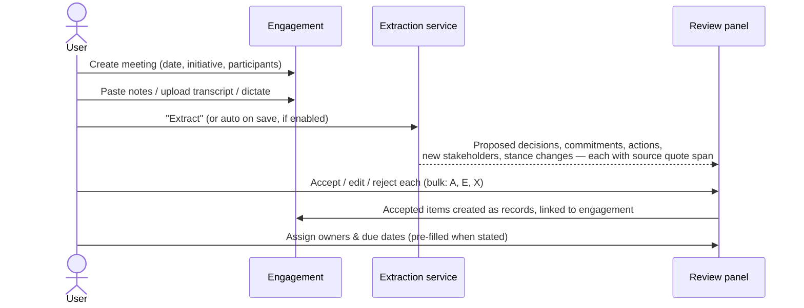

# Critical User Journeys

Status: Foundation draft · 2026-10-22 · See [information architecture](information-architecture.md) for navigation and [AI layer](../architecture/ai-intelligence-layer.md) for suggestion mechanics.

Conventions: **⌨** keyboard path · **State** UI states to design · **Err** error and edge cases · **Perm** permission rules.

---

## Journey A: First-time onboarding

**Goal:** a new workspace reaches a meaningful first view in under 10 minutes. **Activation event:** ≥ 20 stakeholders, ≥ 1 initiative, ≥ 3 engagements in 7 days.

| Step | Screen | Detail |
|---|---|---|
| A1 | **Sign up** | Email magic link or Google/Microsoft SSO. If the email domain already has a workspace, offer "Request to join" rather than duplicating tenants. |
| A2 | **Create workspace** | Name, URL slug, **data region** (EU/US/AU, which is immutable later; we say so plainly). |
| A3 | **Choose template** | Cards: Infrastructure & Construction · Consulting & Advisory · Enterprise Transformation · Public Sector · Nonprofit · General. Each previews its vocabulary (e.g. "Project", "Landowner", "Community commitment") and default classifications. Option: "Start blank". |
| A4 | **Invite teammates** | Paste emails or skip. Role defaults to Member. Domain auto-join toggle for admins. |
| A5 | **Add stakeholders** | Three paths: **Import CSV/XLSX** (column mapping, duplicate detection preview), **Add a few manually** (fast inline table entry), **Explore with sample data** (clearly labelled sandbox initiative that can be deleted in one action). |
| A6 | **Create first initiative** | Name, owner, dates, description. Prompt to attach the stakeholders just added and to set influence/interest in a quick 2×2 drag grid. |
| A7 | **Land on Home** | A first-run checklist (dismissable) replaces the empty "Needs attention": *Log your first engagement · Record a commitment · Try ⌘K*. |

**State:** template preview loading skeleton; import progress with row-level validation; sandbox banner ("Sample data — not real").
**Err:**
- Import file > 10 MB or > 20k rows → offer chunked background import with email on completion.
- Unmappable columns → map to a new custom field or skip.
- Duplicate stakeholders (same email, or fuzzy name+org) → merge / keep both / skip, decided in bulk.
- Invitee already belongs to another tenant → allowed; tenants are isolated.
- Region choice later regretted → support-led migration only; not self-serve.
**Perm:** only the workspace creator (Owner) sees billing and region. Invitees cannot change the template.
**Edge:** user abandons mid-onboarding → resume at the last step; the workspace exists in "setup" state.

---

## Journey B: Stakeholder management

**Goal:** add a person and make them useful context in under a minute.

| Step | Detail |
|---|---|
| B1 Add stakeholder | ⌨ `C` then `P`, or "New person" in Stakeholders. Fields: name (required), title, email, phone, notes. Typing an email domain suggests the organization. |
| B2 Associate organization | Select or create an organization. Affiliation has **role/title, start date, optional end date, primary flag**. Multiple affiliations allowed (e.g. a councillor who also chairs a residents' association). |
| B3 Classify | Influence (Low–Very high), Interest (Low–Very high), **Stance** (Champion · Supporter · Neutral · Concerned · Opposed · Unknown). Classifications are **scoped**: workspace-level default, overridable per initiative. Each change records who, when and an optional rationale, which drives the history timeline. |
| B4 Connect to initiatives | Add to one or more initiatives with an initiative role (e.g. Approver, Affected party, Sponsor). |
| B5 Record engagement | From the profile: "Log engagement" → type, date, participants (this person pre-filled), summary, linked initiative. |

**State:** profile with no engagements shows "No engagement recorded yet. Log one, or import from email (coming soon)". Never a fabricated "health score".
**Err:**
- Possible duplicate on save → inline banner "Looks like Jane Doe (Acme) — open / merge / continue".
- Merge conflict (two values for one field) → field-by-field picker; merge is audited and reversible for 30 days.
- Person leaves an organization → end-date the affiliation, never delete it; history is preserved.
**Perm:** Contributors can create stakeholders but not change workspace-level classifications. **Restricted** stakeholders: visible only to listed users/teams. Others see "Restricted record" in places where a reference is unavoidable (e.g. as an engagement participant). Name and details stay hidden.
**Edge:** a stakeholder with no email or organization (e.g. community member): allowed. A deceased or "do not contact" flag suppresses signals and outreach suggestions.

---

## Journey C: Meeting intelligence

**Goal:** turn a meeting into structured, owned follow-through in under 3 minutes, with humans in control.

| Step | Detail |
|---|---|
| C1 Record meeting | From calendar (v1.1) or manual. Initiative, type, date/time, location/channel. |
| C2 Capture participants | Search stakeholders and teammates; unknown names → "Create stakeholder" inline or leave as unlinked attendee text. Mark attendance (attended / apologies). |
| C3 Notes | Rich text editor. Paste or upload `.txt`/`.docx`/`.vtt` transcripts (≤ 2 h). |
| C4 Summarize | AI summary placed in a distinct "AI draft" block. The user can edit; on save it becomes user-owned text with an "AI-assisted" marker. |
| C5 Extract | Proposed items are shown in a side review panel, each with: type, text, suggested owner/counterparty/due date, **source span** (click highlights the sentence in the notes), confidence band (High/Medium/Low) and an "Inferred" tag where nothing was explicitly stated. |
| C6 Review | Accept, edit-then-accept, or reject (optional reason that feeds evals). Nothing is created until accepted. |
| C7 Assign | Owner required for commitments and actions; counterparty optional; due date may be "unspecified" (flagged in signals). |

**State:** extraction in progress (streaming items appear as found); partial failure ("Extracted 6 items; the transcript's last 20 minutes couldn't be processed, retry"); zero items ("No decisions or commitments detected", with a link to add one manually).
**Err:**
- AI disabled for workspace → the extract button is hidden; manual "Add commitment from selection" still works (select text → ⌘⇧C).
- Notes contain instructions such as "ignore previous instructions" → treated as content; see injection defences in the AI doc.
- Participant not in workspace → suggestion to create stakeholder, never auto-created.
- Duplicate commitment already exists → "Similar to C-142 (open). Link instead?"
**Perm:** extraction runs only over the engagement's content and records the user may access. Accepted items inherit the engagement's initiative visibility.
**Edge:** meeting with restricted participants → AI context excludes their profile data unless the user has access; the notes themselves are already visible to the user.

---

## Journey D: Decision tracking

| Step | Detail |
|---|---|
| D1 Create decision | Title, question/context, initiative, options considered (optional), decision owner, needed-by date. Can be created from an engagement extraction or from scratch. |
| D2 Identify stakeholders | Link stakeholders by role: **Approver**, **Consulted**, **Informed**, **Affected**. The map shows them highlighted. |
| D3 Record approvals | Each Approver gets an approval row: Pending → Approved / Approved with conditions / Rejected / Abstained, with date, method (meeting, email, signed doc) and evidence link. Internal users may approve in-app; external approvals are *recorded by* a user with evidence. |
| D4 Monitor | Status derived: Draft → Open → Awaiting approval (n of m) → Decided / Rejected / Withdrawn / Superseded. Overdue approvals surface in Home and in the owner's inbox. |
| D5 Capture outcome | Outcome text, rationale, effective date, resulting commitments (create linked). Decisions are **immutable once decided**; changes require a superseding decision linked to the original. |

**State:** approvals progress indicator (e.g. "2 of 3 approved"); conditional approvals display their conditions as linked commitments.
**Err:** approver leaves the organization mid-flow → flag and suggest reassignment; decided record edited → blocked, offer "Supersede". Quorum rules (v1.5): "any 2 of 4".
**Perm:** only owner/Admin can mark decided. Approvers see their pending approvals in Inbox. Viewers read-only.
**Edge:** a decision spanning multiple initiatives → one primary initiative plus linked initiatives.

---

## Journey E: Relationship exploration

| Step | Detail |
|---|---|
| E1 Open map | From Stakeholders (`V M` toggles view) or an initiative's Stakeholders tab. Default scope: the current initiative, or "My stakeholders" if none. **Never the whole workspace unscoped.** |
| E2 Filter | Chips: initiative, organization, group, relationship type, influence ≥, stance, last engaged. Layout re-flows with a 200 ms transition. |
| E3 Explore | Hover highlights first-degree neighbours and dims the rest. Click selects and opens the side panel. Double-click expands neighbours (+n badge shows hidden count). Path finder: "How are we connected to [person]?" shows the shortest evidenced paths through recorded relationships and colleagues. |
| E4 Inspect | Side panel: briefing summary, classifications, last engagement, open commitments/decisions, relationship list with evidence. |
| E5 Act | Panel actions: Log engagement · Create commitment · Add to decision · Assign relationship owner. "Gaps" lens: high-influence stakeholders with no relationship owner or no engagement in N days. |

**State:** > 300 nodes in scope → cluster by organization with counts; prompt to refine filters. Empty: "No relationships recorded for this initiative — add one from any stakeholder's Relationships tab."
**Err:** layout computation > 1.5 s → show list view with "Map is still loading" and progressive render.
**Perm:** restricted nodes are omitted entirely (no anonymous node, no edge), so their existence cannot be inferred.
**Accessibility:** "List view" equivalent always one key away (`V L`); keyboard traversal of neighbours with arrow keys; screen reader announces "Jane Doe, Very high influence, Concerned, 4 connections".

---

## Journey F: Executive reporting

| Step | Detail |
|---|---|
| F1 Select initiative | Reports → "Initiative report" → choose initiative and period (default: since last report or 30 days). |
| F2 Review engagement | Sections: engagement volume by stakeholder group, coverage of high-influence stakeholders, cooling relationships. Charts link to filtered tables. |
| F3 Outstanding commitments | Overdue / due soon / closed this period, with owners. |
| F4 Generate summary | AI drafts an executive summary of ~250 words where **every sentence carries citations** (superscript chips → open record). Facts and inferences are visually distinguished; inferences are phrased as such ("Engagement with the council has declined: 1 meeting in 60 days vs. 5 in the prior 60"). |
| F5 Edit & publish | User edits; uncited added text is fine (it's theirs) but is not marked as AI. Export PDF/DOCX, or share a read-only link (expiring, permission-checked). Snapshot frozen at export time with a timestamp. |

**State:** a report with insufficient data shows "Too little recorded activity to summarise this period" instead of padding.
**Err:** citations pointing to records the *recipient* can't access → in shared links, the cited record title is hidden ("Restricted source"). In PDF exports the generator warns the author before export.
**Perm:** only Members+ generate reports; Viewers can view saved reports.

---

## Cross-journey states checklist

Every screen must specify: **empty · loading (skeleton) · partial · error (retryable / non-retryable) · offline (read cached, queue capture) · no permission · restricted record reference · AI disabled · AI unavailable (provider outage → features degrade gracefully, never block manual work).**
